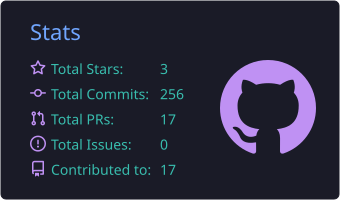
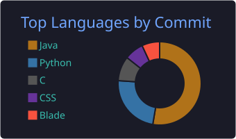

# 👋 Hello, I'm Arthur D'Avila

- 🎓 Computer Science student at UVV (Universidade Vila Velha), 4th semester
- 💻 Backend developer in training, expanding into data and AI
- 🔧 Currently focused on PHP/Laravel, with a solid base in Java and Spring Boot
- 🚀 Interning at Orbtex Brasil, building REST APIs with PHP/Laravel and third-party integrations (insurers, health operators, consortium administrators)
- 🔬 Undergraduate research scholar (PIIC/UVV), developing a fullstack anti-plagiarism system for text

### 📌 Focus areas
- **Backend & REST APIs**: authentication, authorization, access control
- **Data**: analysis with Python, data modeling, SQL
- **AI**: LLMs and RAG applications
- **DevOps**: Docker, CI/CD with GitHub Actions

---

# 🚀 Tech Stack

**Languages**
 

**Backend & AI**
 

**Databases**
 

**Tools & DevOps**
 

**Security, Docs & Testing**
 

### 📚 Currently learning
- RAG pipelines: embeddings, vector search (pgvector), LLM evaluation
- CI/CD with GitHub Actions
- Data analysis with Python (pandas)
- Linux & Bash scripting

---

# 📌 Featured Projects

### 🔹 [apidocs-rag](https://github.com/ArthurDavila879/apidocs-rag) · *in progress*
RAG assistant that answers questions about API documentation (OpenAPI specs), built with **Python + FastAPI**.

- 🧠 **RAG:** embeddings + vector search with PostgreSQL/pgvector, answers generated by an LLM (Gemini)
- 📄 **Data source:** OpenAPI spec of Banco Central's Pix API as the sample documentation
- 🐳 **Infra:** Docker Compose (API + PostgreSQL/pgvector)

### 🔹 [TaskApi (Laravel)](https://github.com/ArthurDavila879/TaskApi_Laravel)
REST API for users and tasks built with **PHP + Laravel**.

- 🔐 **Auth & access control:** Laravel Sanctum (tokens with abilities) + role-based access (admin/user) via Policies and Middleware
- 🏗️ **Architecture:** Service layer, FormRequests and JsonResources
- 🌐 **Integrations:** ViaCEP API, email notification on task creation
- 📄 **Docs:** OpenAPI via dedoc/scramble
- ✅ **Testing:** automated feature tests (`php artisan test`)
- 🐳 **Containerization:** Docker, with a React front-end consuming the API

### 🔹 [Task Manager API (Spring Boot)](https://github.com/ArthurDavila879/spring-task-api)
Secure REST API built with **Java + Spring Boot**.

- 🔐 **Auth:** JWT (HMAC256) + Spring Security with role-based access control
- 🔑 **Security:** BCrypt password hashing, DTOs to control data exposure
- 🗄️ **Persistence:** MySQL with one-to-many relationships
- ✅ **Testing:** JUnit 5 + Mockito
- 📄 **Docs:** Springdoc OpenAPI / Swagger UI
- 🐳 **Containerization:** multi-stage Dockerfile + Docker Compose (API + MySQL)

---

# 📊 GitHub Stats

  
  

---

# 🎓 Certifications
- Oracle Java Foundations
- Oracle Database Foundations
- Git & GitHub (FGV)
- Excel (Bradesco)

---

# 📫 Contact

